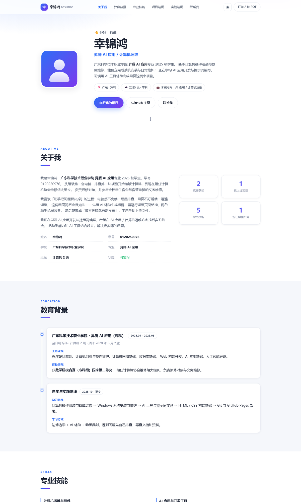

# 个人网页简历 · resume-website

> 《前端框架应用开发》课程作业 —— 一个零依赖、零构建的响应式个人简历网站，
> 推送代码后由 **GitHub Actions** 自动发布到 **GitHub Pages**。

👤 幸锦鸿 · 广东科学技术职业学院 昇腾 AI 应用专业

🔗 在线预览：<https://kijin666.github.io/resume-website/>
📦 源码仓库：<https://github.com/kijin666/resume-website>



---

## 一、这个项目有什么

| 特性 | 说明 |
| --- | --- |
| 响应式布局 | 桌面 / 平板 / 手机三档断点，手机端自动收起为菜单 |
| 深浅色主题 | 右上角 ☀/☾ 一键切换，选择记在 `localStorage` 里 |
| 滚动动画 | `IntersectionObserver` 实现进场动画、技能条加载、数字滚动 |
| 打字机标题 | 首屏文字循环打字效果 |
| 打印 / 存 PDF | 点「打印 / 存 PDF」按钮或 `Ctrl+P`，自动隐藏导航等无关元素 |
| 自动部署 | `.github/workflows/deploy.yml` 实现 push 即上线（CI/CD） |
| 无任何依赖 | 不用 npm、不用打包，浏览器直接打开就能跑，最适合交作业 |
| 调试参数 | `?theme=light` / `?theme=dark` 强制主题；`?static=1` 关闭全部动画（方便截图、导出 PDF） |

---

## 二、目录结构（重点：先看懂这张图）

```
resume-website/
├── index.html                    # 页面结构（所有文字内容都在这里）
├── css/
│   └── style.css                 # 所有样式，文件内按 01~15 分节注释
├── js/
│   └── main.js                   # 交互脚本，文件内按 1~8 功能编号
├── assets/
│   ├── avatar.svg                # 头像占位图（可换成自己的 avatar.jpg）
│   ├── favicon.svg               # 浏览器标签页小图标
│   └── preview.png               # README 里展示的页面预览图
├── .github/
│   └── workflows/
│       └── deploy.yml            # CI/CD：自动部署到 GitHub Pages
├── .gitignore                    # 告诉 Git 哪些文件不用上传
├── 本地预览.bat                   # 双击即可在浏览器打开页面
├── README.md                     # 本文件
└── GitHub上传与部署教程.md         # 从装 Git 到上线部署的完整教程
```

一句话理解三者关系：
**`index.html` 决定「有什么内容」→ `style.css` 决定「长什么样」→ `main.js` 决定「怎么动」。**

---

## 三、本地运行（30 秒）

**方式 A：最简单**
双击 `index.html`（或双击 `本地预览.bat`）。

**方式 B：用编辑器打开**
1. 打开 Trae IDE / VS Code；
2. `文件 → 打开文件夹` 选择 `resume-website`；
3. 右键 `index.html → 在浏览器中打开`，或装 **Live Server** 插件预览（改代码后浏览器自动刷新，推荐）。

> ⚠️ 一定要用「打开文件夹」的方式，不要只拖单个 html 文件，否则 css/js 的相对路径会找不到。

---

## 四、内容怎么改（信息已经填好了）

页面里现在写的是你的真实信息，以后想改，直接改 `index.html` 里的文字即可，**不需要动 CSS 和 JS**。

| 想改什么 | 去哪里找 |
| --- | --- |
| 姓名 | 导航 logo、首屏大标题、关于我、页脚，共 4 处 |
| 学号 / 学校 / 专业 / 班级 | 「关于我」的 6 条信息 + 「教育背景」卡片 |
| 邮箱 / 手机 / 微信 / GitHub | 页面最下方「联系我」四张卡片（`href` 和显示文字都要改） |
| 自我评价那句话 | 搜「勉强算个人」 |
| 荣誉、实践经历 | 搜「荣誉与自我评价」「实践与校园经历」 |
| 头像 | 把照片命名 `avatar.jpg` 放进 `assets/`，再把 `index.html` 里的 `assets/avatar.svg` 改成 `assets/avatar.jpg` |
| 主题配色 | `css/style.css` 最上面的 `:root` 里改 `--brand` 和 `--brand-2` 两个变量，整站换色 |

### 关于「AI 辅助」这件事怎么写更合适

简历里我写的是「**AI 辅助生成 + 手工调整**」，这是准确的说法。需要提醒一句：

> 前端网页是由 **HTML（结构）/ CSS（样式）/ JavaScript（交互）** 三种文件组成的，
> **Python 是后端语言**，一般不直接写前端页面。如果答辩时被问到「这个网页是用什么写的」，
> 回答「HTML + CSS + JavaScript，用 AI 辅助生成初稿后自己调整」才是对的。
> 如果你确实还写过 Python 脚本（比如处理数据、生成文件），可以单独作为一个项目写上去。

---

## 五、后续怎么维护（课程要求的「如何增加项目」）

### 场景 1：新增一个项目经历（最常用）
1. 打开 `index.html`，搜 `项目卡片模板`；
2. 把注释里的 `<article class="project card reveal"> ... </article>` 整段复制出来，去掉注释符号 `<!--` 和 `-->`；
3. 改标题、描述、技术栈和链接即可。
   （`reveal` 这个 class 会让新卡片自动带上滚动动画，不用改 JS / CSS。）

### 场景 2：新增一段实践经历
在「实践与校园经历」区块里复制一个 `<article class="timeline__item reveal"> ... </article>` 即可。

### 场景 3：新增一个简历板块（例如「证书」）
```html
<!-- 1. index.html：在 <main> 里加一个区块 -->
<section class="section" id="awards">
  <div class="container">
    <header class="section__head reveal">
      <p class="section__eyebrow">AWARDS</p>
      <h2 class="section__title">证书</h2>
    </header>
    <p class="reveal">这里写内容……</p>
  </div>
</section>
```
```html
<!-- 2. 顶部导航里加一个入口 -->
<li><a href="#awards" class="nav__link">证书</a></li>
```
保存后刷新即可：滚动动画、导航高亮都会自动生效，**不需要改任何 JS**。

### 场景 4：改完就上线（每天都会用到的三条命令）
```bash
git add .
git commit -m "更新简历内容"
git push
```
push 之后约 30 秒网站自动更新。

---

## 六、部署到 GitHub（完整教程）

详细步骤、命令、以及常见报错处理，见同目录下的：

📄 **[GitHub上传与部署教程.md](./GitHub上传与部署教程.md)**

简要流程：安装 Git → 配置身份 → GitHub 新建仓库 `resume-website` → 本地推送 → 仓库 Settings → Pages 选择 **GitHub Actions** → 等 1 分钟 → 访问 <https://kijin666.github.io/resume-website/>。

---

## 七、代码结构小抄（上台讲解用）

- **HTML**：用语义化标签 `header / nav / main / section / article / footer` 组织；每个板块用 `id` 锚点，导航靠 `href="#id"` 跳转。
- **CSS**：
  - 变量集中在 `:root`，深色主题只是覆盖一遍变量（`html[data-theme="dark"]`），所以换肤几乎零成本；
  - 布局用 `Grid` 做两栏结构、`Flex` 做一行内的排列；断点 `980px / 560px` 两级响应式；
  - `.reveal` 是动画的开关，配合 JS 添加的 `.is-visible` 类完成淡入上移。
- **JS**：全部包在 `(function(){ ... })()` 立即执行函数里，避免污染全局变量；用 `$ / $$` 两个小工具函数代替重复的 `document.querySelector`；每个功能都有编号注释，改哪块看哪块。
- **CI/CD**：`.github/workflows/deploy.yml` 里 `on: push` 触发，`build` 打包静态文件、`deploy` 发布到 Pages，两步用 `needs` 串起来。

---

## 八、常见问题

**Q：双击 html 后样式全丢，只有白底黑字？**
A：多半是只打开了单个文件、或把 html 移出了文件夹。确保 `css/`、`js/`、`assets/` 和 `index.html` 在同一层目录里。

**Q：部署后打开是 404？**
A：① 等 1~2 分钟；② Settings → Pages 里的 Source 是否选了 **GitHub Actions**；③ Actions 页面里最新一次运行是否是绿色 ✔。

**Q：改了代码但网页没变？**
A：按 `Ctrl + F5` 强制刷新（浏览器缓存），或等 Actions 跑完。

**Q：手机号和微信放在公开网页上安全吗？**
A：GitHub Pages 是公开的，任何人（包括搜索引擎）都能看到。介意的话就把「联系我」里的手机 / 微信卡片删掉，只留邮箱和 GitHub。

---

## 九、License

仅用于课程学习与个人展示，可自由修改使用。
